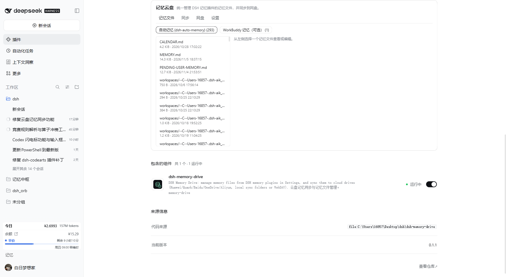

# dsh-memory-drive · DSH Memory Drive

One place inside **Settings → Plugins** to view, edit and delete the memory files written by DSH memory plugins, and to sync them to your own cloud drive.
Only **one drive can be the sync target** (pull + push with a three-way baseline, so multiple drives cannot overwrite each other and scramble memory order); other drives can only receive **upload-only backups**.



## Features

- **Memory file manager**: the settings card lists markdown files from each memory source and lets you view, edit, save and delete them. Deletes go to the plugin trash (recoverable). Saves are hash-guarded: if the file changed elsewhere you get a conflict instead of a silent overwrite.
- **Memory-plugin integration** (auto-detected, extensible):
  - `dsh-auto-memory`: user `MEMORY.md`, `PENDING-USER-MEMORY.md`, `CALENDAR.md`, per-workspace notes, daily logs, `handoff/`, `reflections/`, `archive/` under `~/.dsh/memory`. Internal indexes, vectors and event stores are never exposed.
  - WorkBuddy memory (optional, excluded from sync by default): `~/.workbuddy/MEMORY.md` and `~/.workbuddy/memory/`. That tree is managed by the `huaweicloud-memory-sync` skill; enabling this source for sync may overlap, so it is view-only by default.
  - Custom directories: add any local folder that your cloud-drive client uploads automatically.
- **Cloud drives**:
  - Local sync folders (default, tested): Huawei Cloud Drive, Baidu Netdisk, Quark Drive, Aliyun Drive, OneDrive, 123 Cloud Drive, Tianyi Cloud — detected from common folder names and environment variables, with a manual path fallback.
  - WebDAV (standard protocol): URL + account (Nutstore, Synology, etc.). Credentials stay in the local plugin config.
  - Official OpenAPI adapters are on the roadmap; local sync folders are the fallback until they land.
- **Safe sync semantics**:
  - Cloud layout: `<drive>/DSHMemory/sources/<source>/<root>/<relative path>`; it does not touch the old `WorkBuddyMemory/` tree or other tools' folders.
  - Baseline `~/.dsh/memory-drive/state.json` stores the last agreed hashes: one-sided changes sync, two-sided changes are conflicts — the local file is kept and the cloud version is archived under `~/.dsh/memory-drive/conflicts/<timestamp>/`.
  - Deletions are not propagated automatically; deleted files go to `~/.dsh/memory-drive/trash/<timestamp>/`.
  - The existing huaweicloud-memory-sync skill and its state files are left untouched.

## Install

- Market: search `dsh-memory-drive`.
- GitHub Release:

  ```sh
  dsh plugin --profile <profile> add https://github.com/skyline654654/dsh-memory-drive/releases/latest/download/dsh-memory-drive.tgz
  # or from source (build approval needed)
  dsh plugin --profile <profile> add github:skyline654654/dsh-memory-drive
  ```

Restart DSH, then open **Settings → Plugins → Memory Drive**.

## Data

- `~/.dsh/memory-drive/`: `config.json`, `state.json`, `trash/`, `conflicts/`, `logs/`
- Cloud: `<drive>/DSHMemory/`

## Roadmap (official cloud APIs)

The local-folder backend needs the drive client running and leaves ordering to that client. Official OpenAPI adapters (Baidu OpenAPI, Aliyun Drive OpenAPI, OneDrive Microsoft Graph, …) will take OAuth/access tokens. Huawei Cloud Drive and Quark have no public developer API, so they keep using the local sync folder. Official adapters are not enabled until they can be verified with real credentials.

## Dev

```sh
node --test test/
node --check index.js
```

## License

MIT
