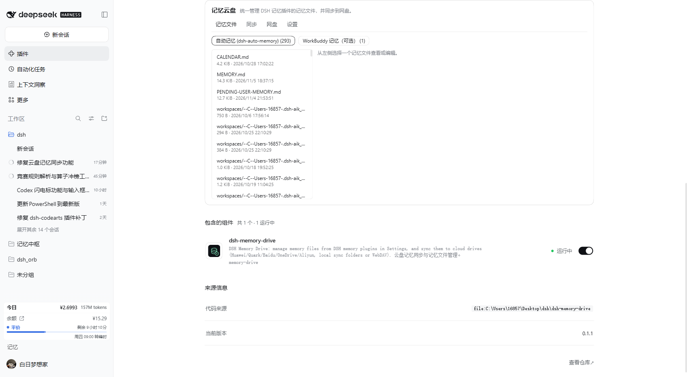

# dsh-memory-drive · DSH 记忆云盘

把 DSH 记忆插件写下的记忆文件集中到「设置 → 插件」里查看、编辑、删除，并同步到你自己的网盘。
一个插件只允许 **一个同步网盘**（拉取+推送、带三方基线，避免多网盘互相覆盖、打乱记忆顺序），其他网盘只能作为 **上传备份**。



## 功能

- **记忆文件管理器**：设置页内的插件卡片直接列出记忆来源下的 Markdown 文件，支持查看、编辑、保存、删除（删除进插件回收站，可恢复）。带 hash 冲突检测，文件在别处被改过时保存会返回冲突而不是覆盖。
- **多来源联动**（自动探测，可扩展）：
  - `dsh-auto-memory`：`~/.dsh/memory` 下的用户级 `MEMORY.md`、`PENDING-USER-MEMORY.md`、`CALENDAR.md`，各工作区 `MEMORY.md`、每日日志、`handoff/`、`reflections/`、`archive/`；内部索引/向量/事件库不会暴露。
  - WorkBuddy 记忆（可选，默认不参与云同步）：`~/.workbuddy/MEMORY.md`、`~/.workbuddy/memory/`。该目录默认由 `huaweicloud-memory-sync` 技能同步，同时启用可能重叠，因此默认只展示、不参与本插件的云同步。
  - 自定义目录：在「网盘」页添加任意本地目录（可自动上传的云盘同步目录）。
- **网盘适配**：
  - 本地同步文件夹（默认、已实测）：华为云盘、百度网盘、夸克网盘、阿里云盘、OneDrive、123 云盘、天翼云盘等客户端暴露在本地的同步目录；按常见目录名与环境变量自动探测，探测不到的可在「网盘」页手动添加路径。
  - WebDAV（标准协议）：可填 WebDAV 地址 + 账号（如坚果云、群晖等）。凭据只保存在本机插件配置文件里。
  - 官方 OpenAPI 适配器是下一步计划（见 Roadmap）；本地同步文件夹是这些官方 API 尚未接入时的备用方案。
- **安全的同步语义**：
  - 云端布局 `<网盘根>/DSHMemory/sources/<来源>/<根>/<相对路径>`，与本插件旧版/其他工具的目录互不干扰。
  - 基线 `~/.dsh/memory-drive/state.json` 记录上次双方 hash：只有一边变化才同步；两边都改过则判为冲突，保留本地文件并把云端版本存到 `~/.dsh/memory-drive/conflicts/<时间戳>/`，绝不静默覆盖。
  - 删除：默认不自动传播到云端/其他机器；文件删除进 `~/.dsh/memory-drive/trash/<时间戳>/`。
  - 默认不删除、不覆盖旧版 `huaweicloud-memory-sync` 技能使用的 `WorkBuddyMemory/` 目录。

## 安装

- 市场：插件市场搜索 `dsh-memory-drive` 安装。
- 本地 / GitHub Release：

  ```sh
  # 从 GitHub Release 预构建包（推荐，免构建授权）
  dsh plugin --profile <profile> add https://github.com/skyline654654/dsh-memory-drive/releases/latest/download/dsh-memory-drive.tgz
  # 或从源码（需要构建授权）
  dsh plugin --profile <profile> add github:skyline654654/dsh-memory-drive
  ```

安装后重启 DSH，打开 **设置 → 插件 → 记忆云盘**。

## 数据与配置

- 插件数据：`~/.dsh/memory-drive/`
  - `config.json` 设置（同步网盘、备份网盘、自动同步开关、来源开关）
  - `state.json` 同步基线
  - `trash/` 删除的文件、`conflicts/` 冲突时的云端副本、`logs/` 日志
- 云端：`<同步网盘>/DSHMemory/`
- 兼容性：不修改 `huaweicloud-memory-sync` 技能与 `~/.workbuddy` 下的同步状态文件；本插件使用独立的目录与基线。

## Roadmap（官方云 API）

本地同步文件夹依赖网盘客户端在线，且同步顺序由客户端决定。官方 OpenAPI 适配器会走各网盘开放平台（OAuth/access token）：
百度网盘开放平台、阿里云盘开放平台、OneDrive Microsoft Graph 等；华为云盘/夸克网盘没有公开的官方开放平台，继续使用本地同步目录。
这类适配器需要开发者应用凭据并做真机验证，因此不会在未验证的情况下默认启用。

## 开发与测试

```sh
npm test
node --check index.js
```

## License

MIT
